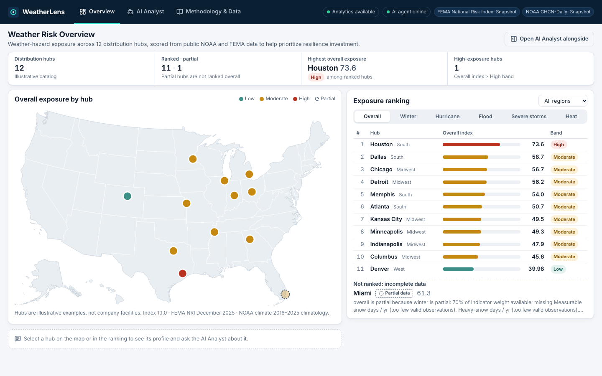
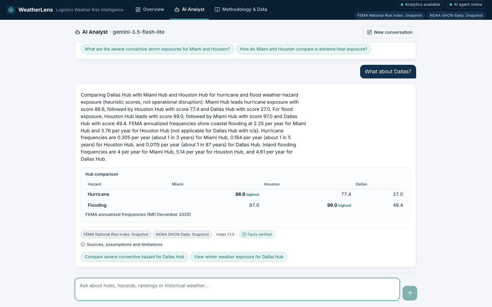
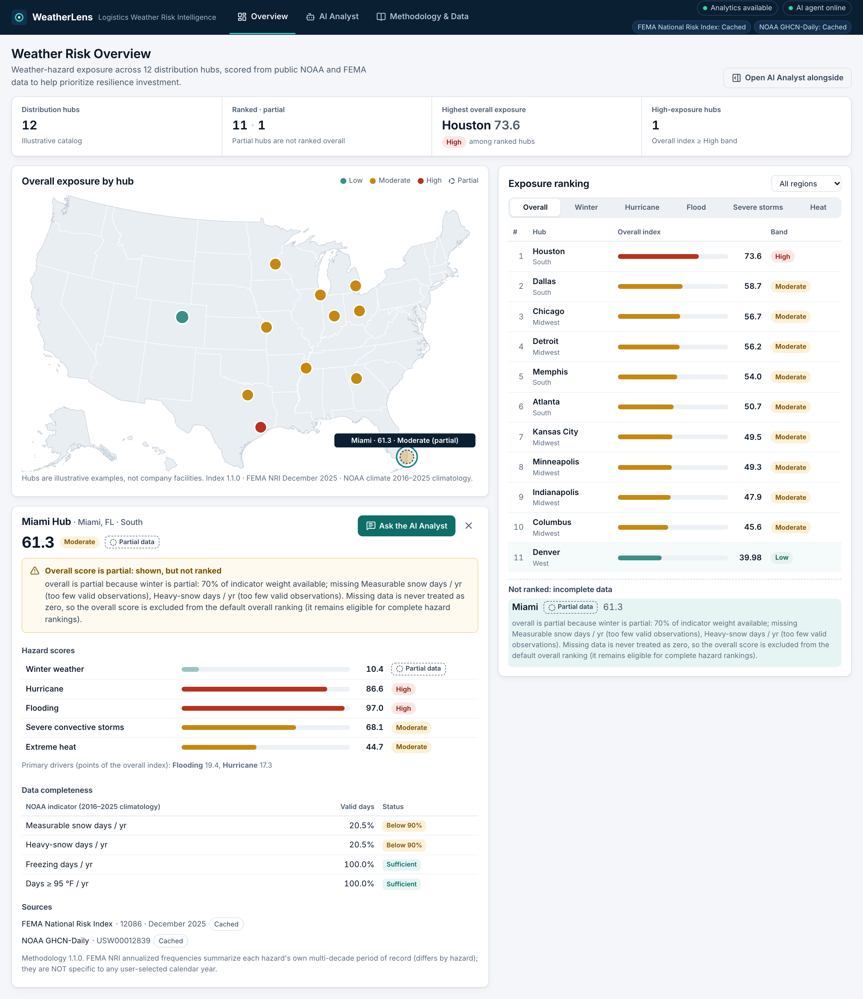

# WeatherLens — Logistics Weather Risk Intelligence



WeatherLens is an AI agent for logistics analysts. It answers questions about which US distribution hubs are most exposed to severe weather, as an input to choosing hubs for resilience investment. It uses public weather and hazard data. A deterministic engine computes every number, score and ranking. The LLM (Gemini) chooses which analysis tools to call and writes an explanation around verified facts. It never writes the numbers itself.

> Built for the Moveo take-home in one day. It is a local prototype, not a production system. One-page summary: [OVERVIEW.md](OVERVIEW.md). Design: [docs/ARCHITECTURE.md](docs/ARCHITECTURE.md).

## The business problem, and what it answers
Severe weather closes hubs, delays shipments and costs money. Each year the company picks a handful of hubs to invest in. WeatherLens answers the assignment's questions and follow-ups about them:

| Question | What WeatherLens answers (methodology 1.1.0, committed data snapshot) |
|---|---|
| Which Midwest hubs are most exposed to winter disruption? | Minneapolis > Detroit > Chicago > Columbus > Kansas City > Indianapolis (winter exposure) |
| Compare Miami and Houston for hurricane and flood exposure | Miami leads hurricane (86.6 vs 77.4); Houston leads flood (99.0 vs 97.0) |
| What % of days in Denver last year had snowfall? | 2025: **7.14%**, i.e. 26 of 364 valid days with measurable snow. Trace days are reported separately; 2025-05-21 is missing |
| Why is Dallas's weather disruption risk high? | **Premise corrected:** Dallas is *Moderate* (58.7, #2 overall), driven mainly by severe convective storms |

**Exposure, not disruption.** The score is a **Weather Hazard Exposure Index** (0–100): how often hazards occur around a hub. It is not a probability of operational disruption or loss. We have no shipment, downtime, asset-hardening or financial data, and the agent says so when a question asks about "risk". The 12 hubs in [config/hubs.yaml](config/hubs.yaml) are **illustrative**, not real company facilities.

## Capabilities
- **Overview dashboard.**
  - KPIs and a US map of the 12 hubs.
  - Rankings by overall score or by any of five hazards (winter, hurricane, flood, severe convective storms, extreme heat), with an optional region filter.
  - A hub profile with hazard drivers.
  - Hubs with partial data are shown with their reason, not ranked silently.
- **AI Analyst (chat).**
  - Multi-turn conversation ("What about Dallas?", "Now compare their flood exposure").
  - Every answer comes with evidence tables taken from the engine's structured output, plus sources, data freshness and a validation badge.
- **Methodology view:** every weight, anchor, threshold, dataset version and freshness, served by the API.
- **Grounded answers.**
  - The LLM cites facts by id (`{{fact:…}}`) and the server renders the values.
  - A validator rejects invented numbers, facts attributed to the wrong hub, unsupported "highest/most exposed" claims and uncorrected false premises.
  - On failure there is one corrective retry, then a clearly labeled deterministic summary. A fabricated answer is never shown.
- **Honest handling of edge cases.** Unsupported hubs and hazards, missing data (e.g. Miami snowfall coverage), ambiguous questions, prompt injection and an unavailable LLM each get an explicit answer or a clarifying question.

| AI Analyst with real Gemini (follow-up) | Hub profile |
|---|---|
|  |  |

## Quick start
Requirements: [uv](https://docs.astral.sh/uv/) (it installs Python 3.12) and Node.js ≥ 20.

```bash
uv sync --frozen && make web-install   # backend + frontend from lockfiles
cp .env.example .env                   # then set GEMINI_API_KEY=... (only the AI Analyst needs it)
make dev                               # API on :8000 + WeatherLens on http://localhost:5173
```
- **Without a key,** Overview and Methodology work fully, and the AI Analyst says it is unavailable.
- **Without network for weather data:** `WEATHER_RISK_OFFLINE=true make dev` serves data from the committed snapshot. Gemini still needs the internet.
- **Port conflicts:** `make dev WEB_PORT=5181`. `API_URL=http://127.0.0.1:8010` points the frontend proxy at a backend on another port.
- **Key handling:** the browser only talks to the Vite server, which proxies `/api` to FastAPI, so the Gemini key stays on the server.

### Environment (`.env`, gitignored; see [.env.example](.env.example))
| Variable | Default | Purpose |
|---|---|---|
| `GEMINI_API_KEY` | — | Enables the AI Analyst. Server-side only, loaded as `SecretStr` |
| `WEATHER_RISK_GEMINI_MODEL` / `WEATHER_RISK_GEMINI_FALLBACK_MODEL` | `gemini-3.5-flash-lite` / `gemini-3.6-flash,gemini-3.5-flash` | Fail-fast model chain |
| `WEATHER_RISK_LLM_TIMEOUT_SECONDS`, `WEATHER_RISK_LLM_MAX_ATTEMPTS` | 45, 3 | Per-call timeout; whole-chain rounds |
| `WEATHER_RISK_LLM_THINKING_LEVEL` | low | Gemini thinking level |
| `WEATHER_RISK_OFFLINE` | false | Weather data from cache/snapshot only |

### API (OpenAPI docs at `http://127.0.0.1:8000/docs`)
```bash
curl -s localhost:8000/api/hubs/dallas_tx/scores     # deterministic, no LLM
curl -s -X POST localhost:8000/api/chat -H 'Content-Type: application/json' \
     -d '{"message": "Which hubs in the Midwest are most exposed to winter disruption?"}'
# follow-up: add "session_id" from the previous response
```
- **Endpoints:** `/api/health`, `/api/hubs`, `/api/hubs/{id}/scores`, `/api/overview`, `/api/rankings`, `/api/methodology`, `POST /api/chat`, `/api/sessions/{id}`.
- **Chat responses** keep the narrative (`answer`) separate from the authoritative structured output (`analysis`, `facts`, `sources`, `data_freshness`, `validation`, `agent`).

## Tests and evaluation
```bash
make test         # backend: offline unit tests (no network, no key)
make lint         # ruff
make web-test     # Vitest on recorded real API responses
make web-lint     # oxlint + TypeScript
make web-build    # production build
make test-live    # opt-in live checks of NOAA, Open-Meteo and FEMA
make eval         # REAL Gemini: 22 cases / 29 turns -> evals/results/latest.{md,json}
make eval-smoke   # quick subset
make benchmark LABEL=x   # latency breakdown of the 4 assignment questions
```
- **The evaluation** ([evals/cases.yaml](evals/cases.yaml)) drives the real API with real Gemini. Weather data comes from the committed snapshot, with weather APIs blocked.
- **Assertions are objective:** literal expected values, rankings cross-checked against the engine, grounding, tool usage, premise correction, isolation and fabrication refusal. There is no LLM judge.

### Actual results
Final full run `20261125T161815Z-full`, paid Gemini tier, run by the author:

| | Result |
|---|---|
| Overall system | **22/22 cases passed**, 95/95 assertions, 0 critical failures |
| LLM-specific | **19/21** LLM-written and valid. 2 cases (A4 Dallas premise, F1 Denver premise) passed via the labeled deterministic fallback. D1 tests the no-LLM path |
| Latency per turn | median 4.8 s · p90 7.2 s · max 12.3 s |
| Benchmark | median 26.3 s → 5.6 s. Not all of this gain is from code: the billing tier, provider availability and thinking configuration also changed ([PHASE_5_REPORT](docs/PHASE_5_REPORT.md)) |

The earlier failed and crashed runs are kept in [evals/results/](evals/results/). This is a 22-case suite. It shows the system behaves correctly on these cases, not that it is accurate in general.

## Architecture (summary)
```
WeatherLens (React/TS/Vite) ──/api──► FastAPI ──► Agent: Gemini tool loop → 6 typed tools → deterministic engine
                                                        → structured JSON answer (schema) → grounding validator
                                                        → fact rendering | one retry | labeled deterministic summary
                                       engine ──► DataRepository: SQLite cache → live API → stale cache → committed snapshot
```
**Storage:**
- SQLite (stdlib) for the raw-response cache and chat sessions;
- a committed gzip snapshot as the offline fallback;
- YAML for the catalog and methodology.

No external database is needed. Details, diagrams and trade-offs are in [docs/ARCHITECTURE.md](docs/ARCHITECTURE.md).

## Data and scoring
| Data | Source | License |
|---|---|---|
| Daily station observations: snow, precipitation, temperature (primary) | NOAA NCEI GHCN-Daily | Public domain |
| Daily ERA5 reanalysis (alternative, labeled as modeled, never mixed with NOAA) | Open-Meteo archive | CC BY 4.0 |
| County annualized hazard frequencies | FEMA National Risk Index, Dec 2025 | Public domain |

**Indicators:**
- Climate indicators (e.g. snow days, freezing days, hot days over 2016–2025) are scored against fixed anchors.
- FEMA frequencies are scored by blending a national county percentile with an absolute log-frequency scale.

**Combining them:**
- Hazard scores are weighted means of their indicators.
- The overall index is the equal-weight mean of five hazards.
- Bands: Low < 40 ≤ Moderate < 70 ≤ High.

**Missing data:** it is never filled in.
- A hazard is scored only if at least 60% of its indicator weight has data; otherwise it has no score. Below 100% the score is marked partial.
- A hub with a partial hazard still shows its overall score, but it is not ranked overall. Hazard-specific rankings still include it.

Full method: [docs/SCORING_METHODOLOGY.md](docs/SCORING_METHODOLOGY.md). Decision log: [docs/DECISIONS.md](docs/DECISIONS.md).

## Limitations
- **Exposure ≠ disruption.** The index has not been validated against real outages or losses. Its weights and anchors are documented judgment calls.
- **Hub geography is approximate.** Each hub is represented by one airport station and one county. Three stations sit in a neighbouring county, which is recorded as an assumption. County hazard frequency is not site-level exposure.
- **Coverage gaps:** NOAA reports snowfall at Miami on too few days to use. Miami's winter score therefore rests on 70% of its indicator weight, and Miami is not ranked overall.
- **LLM dependence.** The chat needs Gemini and network access. Under provider overload or quota limits it degrades to deterministic summaries or a clear "unavailable" message.
  - Occasionally the model types a value instead of citing it. The validator rejects such an answer, and the user sees the deterministic summary (A4/F1 in the final run).
- **Demo-grade operations.**
  - Access control is an optional shared password.
  - Chat limits, the daily cap and the single AI slot live in process memory, so run exactly one instance; a restart resets the counters.
  - Sessions sit in a local SQLite file and may be lost on redeploys.

  These protections bound spending but do not replace a budget cap on the Gemini project.

## Deployment
WeatherLens deploys as **one Docker service**: FastAPI serves the API and the built React app on the same origin, with the data snapshot baked into the image.
```bash
docker build -t weatherlens .
docker run -p 8000:8000 -e GEMINI_API_KEY=... -e WEATHER_RISK_DEMO_PASSWORD=... weatherlens
```
- **Recommended host:** Render, via `render.yaml`.
- **Health check:** `/api/health`. It stays open even when a demo password is set.
- **Chat protections:**
  - limits per IP, per session and per day;
  - one AI request at a time, with a bounded queue;
  - a 60 s deadline per turn;
  - provider errors are never shown to users.

Steps, environment variables, costs and verification: [docs/PHASE_7_REPORT.md](docs/PHASE_7_REPORT.md).

## Repository
```
config/      hubs.yaml (illustrative catalog), scoring.yaml (methodology 1.1.0)
src/weather_risk/  data/ (adapters, cache, snapshot, repository) · analytics/ (pure engine) ·
             agent/ (Gemini, tools, facts, grounding, sessions, orchestrator) · api/app.py · cli.py
web/         WeatherLens frontend (React 19 + TypeScript + Vite), Vitest, Playwright scripts
evals/       cases.yaml, run.py, results/ (every real run, including failures)
tests/       offline unit tests; opt-in live integration tests
data/snapshot/  committed raw API responses + manifest (offline fallback)
docs/        architecture, methodology, decisions, phase reports, screenshots, AI session
scripts/     benchmark, live smoke, sensitivity, fixture recording, session redaction
```
How the project was built with an AI agent, phase by phase: [docs/ai-session/](docs/ai-session/README.md).

## Attribution
Weather data by [Open-Meteo.com](https://open-meteo.com/) (ERA5, Copernicus/ECMWF). NOAA NCEI GHCN-Daily. FEMA National Risk Index.
