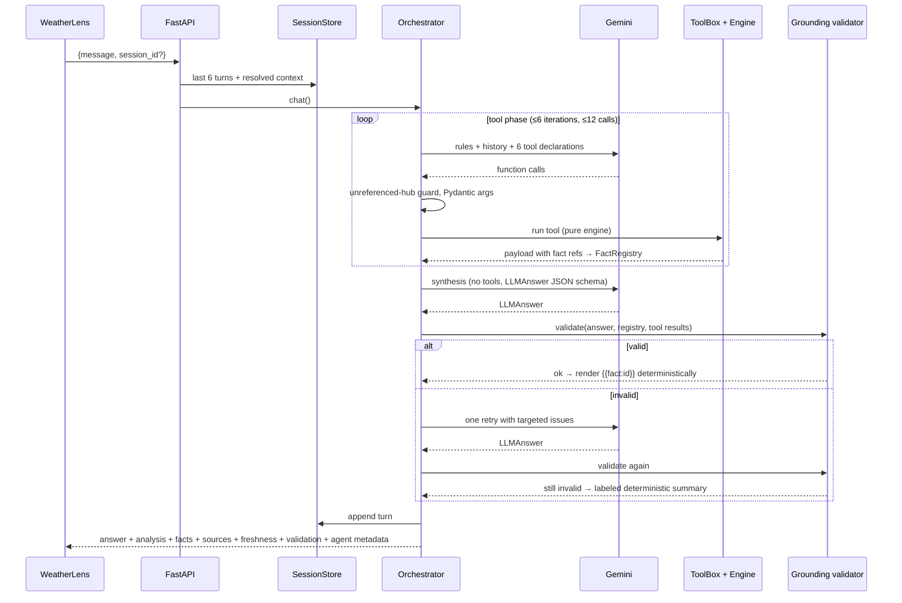

# Architecture

The **Weather Risk Intelligence Agent** answers analysts' questions about weather-hazard exposure of 12 illustrative US distribution hubs. Core principle: **authoritative numbers come from deterministic code, not from the LLM.**
- A deterministic engine computes every statistic, score and ranking from public data.
- The LLM picks tools and writes narrative that references the engine's facts by id.
- The server renders those values and runs a heuristic grounding validator. Its known limits are in §5.2.

## 1. Components and how they talk
```
 WeatherLens (React + Vite)        curl / scripts/live_smoke.py
   browser → Vite dev server ──/api proxy──┐  │
                                           ▼  ▼
 ┌──────────────────────── FastAPI (weather_risk.api.app) ─────────────────────────┐
 │ GET /api/health /api/hubs /api/hubs/{id}/scores /api/overview /api/rankings     │
 │     /api/methodology /api/sessions/{id}          (deterministic, no LLM)         │
 │ POST /api/chat ──► Agent (agent/orchestrator.py)                                 │
 └────────────────────────────────┬─────────────────────────────────────────────────┘
                                  │
        ┌─────────────────────────┼──────────────────────────────┐
        ▼                         ▼                              ▼
  LLM provider              ToolBox (agent/tools.py)       SessionStore (SQLite)
  (agent/gemini.py)         6 typed tools, Pydantic args   bounded history +
   1) tool loop             ──► AnalyticsEngine            resolved context
   2) structured JSON           (analytics/engine.py)
        │                         │  pure scoring, stats, percentiles
        ▼                         ▼
  Grounding validator       DataRepository (data/repository.py)
  (agent/grounding.py)        cache ─► live API ─► stale cache ─► snapshot ─► error
  facts, attribution,         │            │
  numbers, superlatives,      ▼            ▼
  premise                  SQLite cache   NOAA GHCN-Daily · Open-Meteo ERA5 · FEMA NRI
                           (raw bodies)   (+ committed snapshot in data/snapshot/)
```

### Web app (Phase 4)
| View | Endpoints | Notes |
|---|---|---|
| Overview | `/api/overview`, `/api/rankings?hazard=&region=`, `/api/hubs/{id}/scores` | KPIs; self-contained US map (us-atlas Albers + d3-geo; no tiles or keys); rankings with partial hubs listed separately with reasons; hub profile |
| AI Analyst | `/api/chat`, `/api/sessions/{id}` | The narrative is shown as safe Markdown. Evidence blocks are rendered from `analysis` only; numbers are never parsed from prose. Docked beside the dashboard on screens ≥ 1280 px. |
| Methodology & Data | `/api/methodology`, `/api/overview` | All parameters, versions and freshness come from the API |
| Status bar | `/api/health`, `/api/overview` | Separate indicators for analytics availability, AI availability and data freshness |

**Data integrity:** the frontend never computes scores, bands or ranks. It displays the backend's `*_display` strings (band-safe rounding, D-026). Its only local formatting is for raw values such as coverage percentages and frequencies.

**Frontend state:** React state plus one `useChat` hook; no state library.

### Provider resilience and observability (Phase 5)
**Model chain** (`gemini-3.5-flash-lite` → `gemini-3.6-flash` → `gemini-3.5-flash`, thinking level `low`):
- 503, timeout or 429: move to the next model immediately.
- Whole-chain rounds are bounded.
- Day-long quota 429s trip a per-model circuit breaker.
- If synthesis cannot get any model after the tools succeeded, the response is the labeled deterministic summary.

**Observability:** every response carries `agent.timings_ms`:
- tool-selection LLM;
- tool execution;
- synthesis LLM;
- validation;
- provider waits;
- prompt size.

It also carries `agent.llm_calls`: every HTTP attempt, with model, latency, tokens and errors.

**Evaluation:** `evals/run.py` drives the real API with `evals/cases.yaml` (see the README).

### Request flow for `POST /api/chat`
1. **Load the session.** The server reads the last 6 turns and the latest resolved context (hubs, hazards, metric, period) from SQLite. A new session gets an unguessable id.
2. **Tool phase,** at most 6 iterations and 12 tool calls. Gemini receives the system rules, the history and the six tool declarations. For each function call:
   - the server checks that the hubs it names were mentioned by the user or appear in the session context (*no silent guessing*);
   - it validates the arguments with Pydantic and runs the deterministic engine;
   - it registers every number in a per-turn **FactRegistry** (`fact_id → value, display, hub, topic, period, sources`);
   - it returns a compact payload whose numbers are fact references only.
3. **Synthesis.** A second Gemini call, with no tools, returns `LLMAnswer` JSON. The provider enforces the schema natively (`response_json_schema`). This is a separate call because on the live API, combining tools and a schema made the model skip tool calls.
4. **Validation.** `LLMAnswer` is checked in two stages:
   - Pydantic validation of the schema;
   - grounding validation:
     - every fact exists;
     - cited hub = the fact's hub;
     - no fact sits in a sentence about a different hub;
     - no numbers outside placeholders, apart from the allowed contextual literals listed in §5.2;
     - superlatives match the rank-1 hub or the comparison leader *for that hazard*;
     - unsupported premises are corrected.
   - On failure: one retry with targeted feedback.
   - If it still fails: a **clearly labeled deterministic summary** built from the tool results, or an error if there are none.
5. **Rendering.** `{{fact:id}}` placeholders are replaced with deterministic displays, with band-safe score rounding. The response carries the narrative *separately* from the authoritative payloads: rankings, comparisons, statistics, explanations, facts, sources, freshness, methodology version, assumptions, limitations and validation report.

### Agent tools
| Tool | Engine call | Returns |
|---|---|---|
| `list_hubs` | catalog | Hubs (illustrative) |
| `get_hub_profile` | `get_hub_profile` | Overall + five hazard scores, indicators, eligibility |
| `rank_hubs` | `rank_hubs` | Ranked hubs + excluded hubs with reasons |
| `compare_hubs` | `compare_hubs` | Per-hazard scores, leader, difference, FEMA frequencies |
| `get_weather_stat` | `get_weather_stat` | % of valid days, counts, coverage, missing dates |
| `explain_hub_score` | `explain_hub_score` | Hazard-level drivers, indicator contributions, rank, premise check |

## 2. Repository structure
```
config/hubs.yaml, scoring.yaml       illustrative catalog; methodology 1.1.0 parameters
src/weather_risk/
  data/        adapters (NOAA, Open-Meteo, FEMA NRI), http, cache, snapshot, repository, models
  analytics/   periods, stats, percentiles, scoring, engine, formatting, report (no LLM)
  agent/       llm (interface), gemini, fake (tests), tools, facts, grounding, schema,
               session, orchestrator
  api/app.py   FastAPI app factory + endpoints
  cli.py       weather-risk CLI (hubs, snapshot, validate-data, scenarios)
data/snapshot/ committed raw API responses + manifest (offline fallback)
tests/unit/    offline tests (fixtures, snapshot-backed engine, FakeProvider)
tests/integration/  opt-in live data-source tests (-m live)
scripts/       record_fixtures.py, sensitivity.py, live_smoke.py, benchmark.py (REAL Gemini)
evals/         cases.yaml (versioned dataset), run.py (runner), results/ (actual runs)
web/           WeatherLens frontend (src/api, src/components, src/hooks, e2e/)
docs/          plan, decisions, methodology, phase reports, screenshots, AI session export
```

## 3. Data storage choice
| Store | Technology | Why |
|---|---|---|
| HTTP response cache | SQLite (stdlib `sqlite3`), `data/cache/cache.db` | Zero-ops, single file, transactional, queryable. Raw bodies plus integrity hash, so parsers can change without refetching. |
| Offline fallback | Committed gzip snapshot + `manifest.json` | The live demo survives API outages; reproducible; public-domain / CC BY data |
| Conversations | SQLite, `data/cache/sessions.db` | Same rationale. Sessions are isolated by a random id, with bounded history |
| Configuration | YAML (`config/`) + `.env` (secrets, gitignored) | Reviewable parameters. Secrets never in git; loaded as `SecretStr` |

There is no ORM, vector database or external database server, because the data volume is tiny and the access patterns are key lookups.

## 4. Security notes (single-instance demo deployment)
- **Secrets:** the Gemini key stays on the server, in `.env` (gitignored), and is never logged.
- **Input limits:** chat input is limited to 2,000 characters; session ids are validated. Tool arguments are strict Pydantic models (`extra=forbid`, enums, length limits), and tool payloads are capped at 24 KB.
- **Narrow tool surface:** the LLM has no code execution, HTTP or database access, only six read-only tools.
- **Prompt injection:**
  - user text is wrapped as untrusted, and the rules are restated;
  - the grounding validator rejects most numbers that don't come from facts, whatever the model was told (see the limits in §5.2).
- **CORS:** restricted to the local Vite origins. Only GET/POST and `Content-Type` are allowed.
- **Not production-ready:**
  - access control is an optional shared demo password, and rate limits live in process memory (Phase 7);
  - single process and single instance: one AI request at a time behind a bounded queue, with a per-turn deadline (default 60 s); the dashboard only waits on short engine work, never on Gemini;
  - no TLS;
  - session data is not encrypted at rest;
  - the session id is the only access control.

## 5. Flows

### 5.1 Agent sequence (`POST /api/chat`)

If synthesis hits a provider error after the tools have succeeded, the response is the labeled deterministic summary. If no tool could run, the API returns a structured `503`, `429` or `504` error with a `retryable` flag.

### 5.2 Grounding flow
```
tool result ──► FactRegistry: fact_id → {value, display, hub_id, topic, period, sources}
                     │
LLM narrative "Denver had snow on {{fact:denver_co.snow_days_measurable.2025}} of days"
                     │
validate:  1 every fact id exists; cited hub = the fact's hub
           2 no fact sits in a sentence about a different hub
           3 no digits outside placeholders, except years and small counts that occur in tool
             output or the question; the feedback names the matching fact
           4 "highest/most exposed/leads" must match the rank-#1 hub or the comparison leader
             for that hazard (explicit negation exempts a sentence; correction wording exempts
             only premise_correction sentences)
           5 a premise the engine rejects (e.g. "Dallas is high") must be corrected
                     │
render:    placeholders → server-formatted displays (band-safe rounding, units)
```
**What this does and does not guarantee.**
- **Primary control:** rendering, not regexes. Every figure the user sees in an accepted answer comes from the fact registry. The model is told to cite facts by id; the validator is the second line of defence.
- **The model does see the values.** Tool payloads give each number *next to* its fact id, so the model can understand the results. It can therefore copy a value literally; the validator catches that, which is exactly what produced the A4/F1 fallbacks.

**The validator is heuristic. Known limits:**
- **Contextual numeric literals are allowed:**
  - integers 0–12 without a `%` (small counts, list positions);
  - numbers that appear in the user's message or in the descriptive text of tool results;
  - years that appear in fact periods or labels.

  A wrong small count, such as "3 hubs" where there are 4, would not be flagged.
- **Number detection is pattern-based.** Numbers spelled out in words ("seven") are not detected.
- **Attribution is checked per sentence, and only for sentences that name a hub.** It confirms that a fact belongs to a hub mentioned in the same sentence. It does not verify the meaning of the sentence: comparisons such as "higher than" or "driven by", or causal wording, can still be wrong while passing.
- **Superlative checking uses a fixed phrase list** ("highest", "most exposed", "leads", "ranked first", …) with simple negation handling. Other phrasings are not checked.
- **Premise correction is enforced only when a tool reports a premise check.** That happens when `explain_hub_score` receives the user's claimed band; unsupported premises of other kinds rely on the prompt.

In short: an accepted answer's figures are engine figures, but its prose is only spot-checked. The evaluation suite measures how well this works in practice; it does not prove it.

### 5.3 Data ingestion, cache and snapshot
```
engine asks repository for (source, params)
   │
   ├─ fresh SQLite cache entry (sha256 key, body hash OK) ──────────────► freshness=cache
   ├─ live HTTP (timeout, ≤3 attempts, Retry-After capped) → validate → cache ──► live
   ├─ on failure: stale cache entry ─────────────────────────────────────► stale_cache
   ├─ committed snapshot entry (manifest sha256 verified) ───────────────► snapshot
   └─ DataUnavailableError → tool returns "data unavailable; do not estimate"
```
- **Canonical requests:** they are split into calendar-year chunks, so the cache and snapshot keys are stable.
- **TTLs:** 30 days for completed periods, 1 day for periods touching the last 30 days, 7 days for NRI.
- **Integrity:** a corrupt cache entry is evicted and refetched.
- **Freshness:** every response states each source's freshness label, and the UI shows it.

## 6. Why SQLite
- **Fits the workload:**
  - a few hundred cached responses, key lookups, one writer;
  - a session table with bounded history.
  - SQLite gives transactions and integrity with zero operations.
- **Portable:** a single file, in the Python standard library. A fresh clone runs with no database server. The demo also works with an empty cache, from the committed snapshot.
- **Rejected alternatives:**
  - Postgres or Redis would add infrastructure that buys nothing at this scale.
  - A vector database is unnecessary, because there is no retrieval over free text.
  - Plain JSON files would give up atomic writes and concurrent-read safety.
- **Where it stops fitting:**
  - several server instances, which would need a shared session store;
  - multi-user write volume;
  - retention or encryption requirements.

  At that point, sessions move to Postgres or Redis. The read-mostly cache can stay per-instance or move to object storage.

## 7. Deployment considerations
Implemented in Phase 7: `Dockerfile`, `render.yaml` and the protections in `api/guard.py`. Instructions and verification are in [PHASE_7_REPORT.md](PHASE_7_REPORT.md). **Nothing is deployed yet.**
- **Shape.** One container:
  - FastAPI serves the built React assets (`web/dist`) on the same origin, so CORS isn't needed;
  - `uvicorn` sits behind the platform's TLS (Render, Fly.io, Railway or Cloud Run).
- **Secrets.** `GEMINI_API_KEY` is a platform secret, server-side only; the browser never sees it.
- **Data:**
  - ship the committed snapshot in the image;
  - set `WEATHER_RISK_OFFLINE=true` for a deterministic, outage-proof demo, or keep live fetching with the snapshot as fallback;
  - SQLite on ephemeral disk is acceptable (the cache rebuilds, and sessions are disposable for a demo).
- **Health.** `/api/health` reports the methodology version, snapshot entries and LLM availability, and serves as the liveness/readiness probe.
- **Timeouts.** A chat waits at most `WEATHER_RISK_CHAT_QUEUE_TIMEOUT_SECONDS` (30 s) for the AI slot, then runs within `WEATHER_RISK_CHAT_DEADLINE_SECONDS` (60 s). The platform timeout must exceed their sum (about 90 s).
- **Abuse and spend protection.**
  - **Implemented** (Phase 7, `api/guard.py`): per-IP and per-session limits on `/api/chat`, a daily request cap, one AI request at a time with a bounded queue, a per-turn deadline, and an optional shared demo password.
  - **Still a manual step:** a Gemini budget alert or quota limit on the Google Cloud project. This is the real spending guarantee, because the in-app limits reset on restart.
- **Concurrency.** One AI slot is fine for a few interviewers. For more users:
  - move the provider's per-turn state into the request;
  - use per-session locking;
  - keep sessions and limit counters in a shared store (Redis) before adding workers or instances.
- **Cost.**
  - Hosting fits a free or low tier: one small instance.
  - Gemini Flash-Lite pricing at about 2–3 calls per question is small for demo traffic, but it is unbounded without the caps above.

## 8. Trade-offs
| Choice | Benefit | Cost |
|---|---|---|
| Two LLM phases (tools, then a schema-constrained answer) | Reliable tool use plus native JSON-schema enforcement | About 2 LLM round-trips per question |
| Fact placeholders + validator | No invented numbers can reach the user | Occasional valid-but-noncompliant answers fall back to the deterministic summary (A4/F1 in the final run) |
| Deterministic summary fallback | Always a correct, labeled answer when tools succeeded | Less fluent; the user sees it as a lower-quality answer |
| Committed snapshot | Reproducible evals; demo survives outages | ~2.9 MB of gzip data in the repository; data is as of the snapshot date |
| Fixed climate anchors + national FEMA percentiles | Scores don't shift when hubs are added | Anchors are judgment calls (documented, with sensitivity analysis) |
| Strict hub resolution (no fuzzy guessing) | No silent wrong-hub answers | More clarification questions |
| One process, one AI slot, in-memory limits | Simple and race-free; no extra infrastructure | Doesn't scale beyond a demo; a restart resets the counters |
| Domain-specific validator rules | Catch real failure modes seen in evaluation | Regex-based checks need maintenance as phrasing evolves; some rules are heuristic |

**Where the design is heavier than the brief requires:**
- the grounding validator;
- the model fallback chain with a circuit breaker;
- per-turn instrumentation.

Each was added in response to a failure observed in live runs (Phases 3 and 5). For a one-day prototype they are worth keeping, but they add code surface: the agent is about 2,000 lines.

## 9. Future work
- **Outcome validation:** calibrate the exposure index against real hub outage or delay records. This is the step that would turn exposure into disruption risk.
- **Hub-level inputs:** asset vulnerability, criticality, throughput and site coordinates instead of county proxies.
- **Operations:**
  - limits and sessions in a shared store (e.g. Redis), so that several instances can run;
  - user authentication instead of a shared demo password;
  - per-session locking with more than one concurrent AI request;
  - structured log shipping and alerting.
- **Assignment bonus items:** a scheduled score-change alert (cron or webhook) and voice input.
- **Evaluation:**
  - more paraphrases per intent;
  - repeated runs to measure variance (LLM outcomes are not deterministic);
  - track the fallback rate as a KPI.
